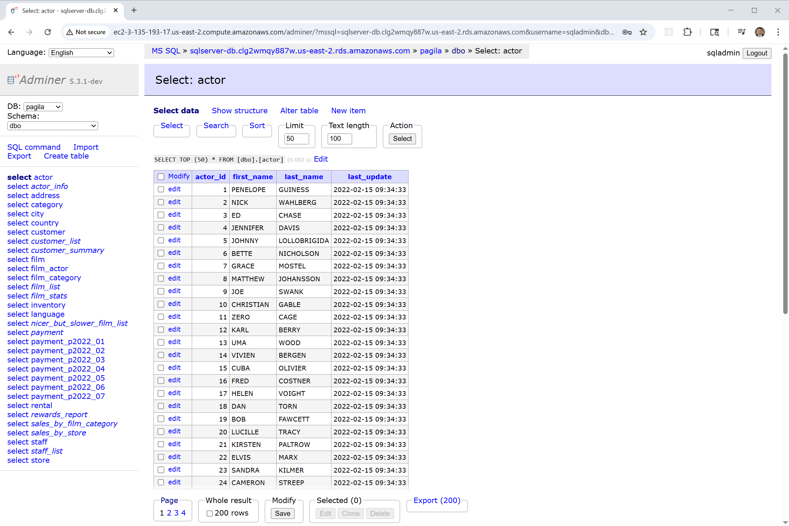
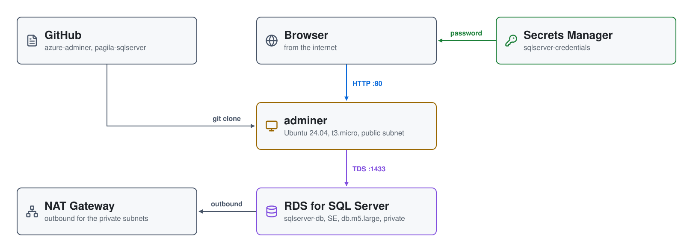

# SQL Server on AWS: Amazon RDS for SQL Server with Adminer

A private **Amazon RDS for SQL Server** instance (Standard Edition, license
included), built with Terraform and loaded with a SQL Server port of the
[Pagila](https://github.com/mamonaco1973/pagila-sqlserver) sample database.
The instance has no public endpoint; an **Adminer** host in the public subnet
gives you a browser client for it.



| Piece | Where | Role |
|---|---|---|
| **RDS for SQL Server** | `private-subnet-1`/`-2` | `sqlserver-db`, `sqlserver-se`, `db.m5.large`, 20 GB gp3 growing to 50 GB, single-AZ, 7-day backups, not publicly accessible |
| **adminer** | `rds-subnet-1` (public) | Ubuntu 24.04, `t3.micro`; loads Pagila with `sqlcmd`, then serves Adminer with the PHP SQL Server drivers |
| **Secrets Manager** | regional | `sqlserver-credentials`: user, password, endpoint |
| **NAT gateway** | `rds-subnet-1` | outbound internet for the private subnets |

## Architecture

<picture>
  <source media="(prefers-color-scheme: dark)" srcset="architecture-dark.svg">
  
</picture>

Regenerate with `python3 make_diagram.py`.

- **`01-rds/`** is the whole stack: the VPC (`rds-vpc`, 10.0.0.0/24) with a
  public `rds-subnet-1` (10.0.0.0/26, us-east-2a) and private
  `private-subnet-1` (10.0.0.64/26, us-east-2a) and `private-subnet-2`
  (10.0.0.128/26, us-east-2b), the internet and NAT gateways, the security
  groups, the SQL Server instance, its credentials, and the Adminer host.

## How it boots

1. Terraform builds the network, the SQL Server instance and the secret,
   generating a 24-character password for the `sqladmin` user.
2. The Adminer host installs Microsoft's `mssql-tools`, clones
   [`pagila-sqlserver`](https://github.com/mamonaco1973/pagila-sqlserver),
   and runs its four scripts with `sqlcmd`: create the `pagila` database,
   then the tables, the data, and the views, functions and indexes. Each step logs to
   `/tmp/<script>.log` and `/tmp/<script>.error`.
3. It installs Apache, PHP and the `sqlsrv` / `pdo_sqlsrv` drivers, clones
   the [`azure-adminer`](https://github.com/mamonaco1973/azure-adminer) fork
   of Adminer into `/var/www/html`, and redirects `/` to `/adminer`.
4. `validate.sh` polls the Adminer URL until it answers (up to 15 minutes),
   then prints it with the SQL Server endpoint.

## Security groups

```
internet ─80, 443─▶ adminer ─1433─▶ RDS for SQL Server (private subnets)
```

`web-sg` allows 80 and 443 from anywhere; only 80 is served. `rds-sg`
allows 1433 from `0.0.0.0/0`, but the instance is in private subnets and not
publicly accessible, so only hosts in the VPC can reach it.

## Prerequisites

* [An AWS Account](https://aws.amazon.com/console/)
* [Install AWS CLI](https://docs.aws.amazon.com/cli/latest/userguide/getting-started-install.html)
* [Install Terraform](https://developer.hashicorp.com/terraform/install)
* [Install jq](https://jqlang.github.io/jq/download/)

If this is your first time watching our content, we recommend starting with
this video: [AWS + Terraform: Easy Setup](https://youtu.be/BCMQo0CB9wk).

## Deploy

```bash
git clone https://github.com/mamonaco1973/aws-sqlserver.git
cd aws-sqlserver
./apply.sh       # one phase: VPC, SQL Server, secret, Adminer host
```

Everything deploys to `us-east-2`. `apply.sh` ends by running `validate.sh`:

```
NOTE: Waiting for Adminer to become available:
NOTE:   http://ec2-203-0-113-10.us-east-2.compute.amazonaws.com/adminer
===============================================================================
BUILD VALIDATION RESULTS
===============================================================================
Adminer URL:
  http://ec2-203-0-113-10.us-east-2.compute.amazonaws.com/adminer

SQL Server RDS Endpoint:
  sqlserver-db.abc123xyz.us-east-2.rds.amazonaws.com
===============================================================================
```

## Try it

1. Get the password:

   ```bash
   aws secretsmanager get-secret-value --secret-id sqlserver-credentials \
     --query SecretString --output text | jq -r .password
   ```

2. Open the Adminer URL and sign in with System **MS SQL**, the SQL Server
   endpoint as Server, user `sqladmin`, that password, and database `pagila`.
3. Run the sample queries from **SQL command**:

   ```sql
   SELECT TOP 100
       f.title AS film_title,
       a.first_name + ' ' + a.last_name AS actor_name
   FROM film f
   JOIN film_actor fa ON f.film_id = fa.film_id
   JOIN actor a ON fa.actor_id = a.actor_id
   ORDER BY f.title, actor_name;
   ```

   ```sql
   SELECT TOP 100
       f.title,
       STRING_AGG(a.first_name + ' ' + a.last_name, ', ') AS actor_names
   FROM film f
   JOIN film_actor fa ON f.film_id = fa.film_id
   JOIN actor a ON fa.actor_id = a.actor_id
   GROUP BY f.title
   ORDER BY f.title;
   ```

## Troubleshooting

| Symptom | Fix |
|---|---|
| `validate.sh` keeps retrying | The host is still installing; the PHP drivers build from source with `pecl`. `aws ssm start-session --target <instance-id>`, then `sudo tail /var/log/cloud-init-output.log`. |
| `pagila` is missing or empty | Read `/tmp/*.error` on the Adminer host; each `sqlcmd` step writes its errors there. |
| Adminer can't connect | Pick **MS SQL** as the System, and use the endpoint without the `:1433` suffix. |
| You want a local client | The instance is private. Connect from the Adminer host, or open an SSM port-forwarding session through it. |

## Teardown

```bash
./destroy.sh     # destroys the whole stack; no final snapshot, secret deleted immediately
```

## Notes

- **Lab only.** Adminer is open to the internet over plain HTTP, and the
  admin password is in the host's user data. Restrict `web-sg` and add TLS
  for anything more.
- SQL Server licensing is included in the RDS hourly price, and
  `db.m5.large` is the largest cost in this lab: run `./destroy.sh` when you
  finish.
